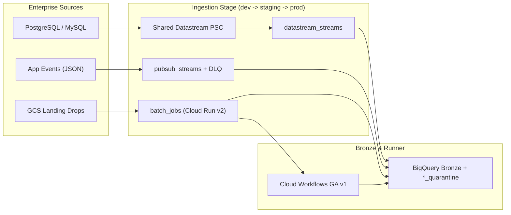

# GCP Data Ingestion

Manage all enterprise Bronze ingestion pipelines inside one private repository across `dev`, `staging`, and `prod`.

This template pairs with [gcp-launchpad](https://github.com/choo737/gcp-launchpad), [gcp-foundation](https://github.com/choo737/gcp-foundation), and [gcp-data-medallion](https://github.com/choo737/gcp-data-medallion).

## Template Suite Overview

Start in [gcp-launchpad](https://github.com/choo737/gcp-launchpad) to route Greenfield or Brownfield deployments across the full template suite.

| Repository | Status | Layer | Responsibility |
| --- | --- | --- | --- |
| [gcp-launchpad](https://github.com/choo737/gcp-launchpad) | Active | Suite Entry Hub | Suite Overview, Architecture Router & Brownfield Bridge (`platform-context.json`) |
| [gcp-foundation](https://github.com/choo737/gcp-foundation) | Active | Platform & Governance | Org guardrails, projects, KMS, datasets, Dataform repo, and Dataplex scans |
| **gcp-data-ingestion** *(this repo)* | Active | Ingestion & Pipeline Runner | Datastream CDC, Pub/Sub streaming, GCS batch loader, and Cloud Workflows |
| [gcp-data-medallion](https://github.com/choo737/gcp-data-medallion) | Active | Warehouse & Quality | Bronze declarations, Silver SCD Type 2, Gold marts, and quality specs |
| `gcp-webapp` *(Planned)* | Roadmap | Application Tier | Regional/multi-region HA web apps on Cloud Run v2 and Cloud SQL |
| `gcp-adk-agent` *(Planned)* | Roadmap | AI Agent Tier | Production Google ADK agents on Vertex AI Agent Engine or Cloud Run v2 |

## Create Your Private Repository (Do Not Fork Publicly)

- GitHub forces standard forks of public repositories to stay public.
- Click **Use this template** on GitHub or run this command:

```bash
gh repo create acme-corp/gcp-data-ingestion --private --template choo737/gcp-data-ingestion --clone
```

## Architecture & Capabilities

One enterprise stage hosts multiple CDC streams, Pub/Sub topics, and Cloud Run batch loaders.



1. **Datastream CDC (`datastream-cdc`)**: Streams PostgreSQL or MySQL changes using Secret Manager passwords and shared PSC connectivity.
2. **Pub/Sub to BigQuery (`pubsub-bigquery`)**: Validates JSON events, applies PII policy tags, and routes errors to quarantine.
3. **Batch ELT Job (`batch-elt-job` + `jobs/gcs_to_bronze/`)**: Runs atomic Cloud Run v2 loads with Direct VPC egress and policy tags.
4. **Pipeline Workflows (`pipeline-workflows` + `workflows/`)**: Triggers batch loads, Dataform GA `v1` runs, Dataplex scans, telemetry, and alerts.

## 6-Step Enterprise Operationalization

Follow [docs/03-enterprise-adoption-guide.md](docs/03-enterprise-adoption-guide.md) to onboard your organization end to end.

1. **Day 0 Repo & Environments**: Create a private repo, protect `main`, and configure `dev`, `staging`, `prod` WIF environments.
2. **Day 1 Link Landing Zone**: Run `scripts/link-stages.sh` (Greenfield) or complete [QUESTIONNAIRE.md](QUESTIONNAIRE.md) and `generate-brownfield-link.py` (Brownfield).
3. **Day 1 Image & Secrets**: Build `gcs-to-bronze@sha256:...` via `build-batch-loader.yml` and store DB passwords in Secret Manager.
4. **Day 1 Promote Baseline**: Deploy `dev` (`enable_schedule = false`) first, then promote `staging` and `prod` (`batch_vpc_egress = "ALL_TRAFFIC"`).
5. **Day 2 Add Pipelines**: Add feeds via `pubsub_streams`, `batch_jobs`, and `datastream_streams` in `envs/<env>.tfvars` without editing `main.tf`.
6. **Day 2 Operate & Scale**: Monitor `pipeline_runs`, replay quarantine data, and keep one repo up to `30` pipelines.

- Brownfield teams can import `platform-context.json` from [gcp-launchpad](https://github.com/choo737/gcp-launchpad) via `generate-brownfield-link.py`.

```bash
# Greenfield Day-1 link from gcp-foundation GCS export:
./scripts/link-stages.sh --env prod --from-gcs gs://example-platform-state/foundation-prod.json stages/enterprise

# Brownfield Day-1 link from gcp-launchpad platform-context.json:
python3 ../gcp-launchpad/scripts/generate-brownfield-link.py \
  --context platform-context.json \
  --output stages/enterprise/00_linked.auto.tfvars.json

# Initialize remote state and deploy an environment:
cp stages/enterprise/envs/prod.tfvars.example stages/enterprise/envs/prod.tfvars
make init STAGE=enterprise ENV=prod TF_STATE_BUCKET=example-tf-state-bucket
make plan STAGE=enterprise ENV=prod
make apply STAGE=enterprise ENV=prod
```

### Day-2 Multi-Pipeline Example

Add streams, batch feeds, and CDC databases directly in `stages/enterprise/envs/<env>.tfvars` and `schemas/`:

```hcl
enable_shared_datastream_private_connection = true

pubsub_streams = {
  crm-events = {
    target_table_id          = "crm_events_stream"
    schema_type              = "PROTOCOL_BUFFER"
    schema_file              = "schemas/pubsub/crm_events.proto"
    target_table_schema_file = "schemas/bigquery/crm_events_bronze.json"
    target_clustering        = ["segment", "event_type"]
  }
}

batch_jobs = {
  erp-invoices = {
    source_prefix            = "incoming/erp_invoices/"
    target_table             = "erp_invoices_bronze"
    source_format            = "NEWLINE_DELIMITED_JSON"
    partition_field          = "invoice_date"
    target_table_schema_file = "schemas/bigquery/erp_invoices_bronze.json"
  }
}

datastream_streams = {
  erp-db = {
    source_engine              = "POSTGRESQL"
    db_host                    = "10.20.2.15"
    db_username                = "datastream_rep"
    db_database                = "erp_prod"
    db_password_secret_version = "projects/example-etl-project/secrets/ent-erp-db-pwd/versions/1"
    included_objects           = { public = ["invoices", "vendors"] }
  }
}
```

## AI Coding Agent Quickstart

Use an AI coding agent with the repository instruction files and workflow skills below.

### Antigravity or OpenAI Codex

```text
Read AGENTS.md, QUESTIONNAIRE.md, and .agents/skills/setup-data-ingestion/SKILL.md.
Check platform-context.json or ask intake questions, create a private repo, link outputs, and deploy stages/enterprise.
```

### Claude Code

```text
Read CLAUDE.md, QUESTIONNAIRE.md, and .agents/skills/setup-data-ingestion/SKILL.md.
Verify gcloud auth, collect intake values, link stages/enterprise, and add pipelines via envs/<env>.tfvars.
```

| Skill | File | Purpose |
| --- | --- | --- |
| `setup-data-ingestion` | `.agents/skills/setup-data-ingestion/SKILL.md` | Private repo creation, stage linking, Terraform deploy, and canary checks |
| `add-streaming-topic` | `.agents/skills/add-streaming-topic/SKILL.md` | Add a schema-checked Pub/Sub BigQuery stream via `pubsub_streams` |
| `add-batch-feed` | `.agents/skills/add-batch-feed/SKILL.md` | Add a Cloud Run v2 GCS batch feed via `batch_jobs` |
| `add-cdc-source` | `.agents/skills/add-cdc-source/SKILL.md` | Add a PostgreSQL or MySQL CDC stream via `datastream_streams` |
| `split-domain-ingestion` | `.agents/skills/split-domain-ingestion/SKILL.md` | Split one ingestion repo into per-domain repos at scale |

## CI/CD Workflows

- `.github/workflows/ci.yml`: Runs formatting, `terraform validate`, and Python unit tests on every push and PR.
- `.github/workflows/build-batch-loader.yml`: Builds `jobs/gcs_to_bronze` with locked hashes and pushes immutable digests when WIF is set.
- `.github/workflows/terraform-deploy.yml`: Plans pull requests and promotes `dev`, `staging`, and `prod` via GitHub Environments.

## Repository Layout

- `modules/ingestion/`: Reusable five-file Terraform modules (`datastream-cdc`, `pubsub-bigquery`, `batch-elt-job`, `pipeline-workflows`).
- `schemas/`: Reusable Proto3/Avro definitions (`schemas/pubsub/`) and BigQuery JSON schemas (`schemas/bigquery/`).
- `stages/sandbox/`: Single-project stage with GCS remote backend and committed `.terraform.lock.hcl`.
- `stages/enterprise/`: Multi-project stage with `envs/{dev,staging,prod}.tfvars.example` and committed `.terraform.lock.hcl`.
- `jobs/gcs_to_bronze/`: Python `3.13` Cloud Run batch loader with pinned digest base image and `requirements.lock`.
- `workflows/`: Cloud Workflows GA `v1` pipeline definition (`medallion_pipeline.workflows.yaml`).
- `composer_reference/`: Reference Airflow DAG (`medallion_composer3_dag.py`) for Cloud Composer 3 scaling.
- `scripts/link-stages.sh`: Local and GCS stage output linker supporting `--env`.
- `QUESTIONNAIRE.md`: Greenfield, Brownfield, and Sandbox intake questionnaire.
- `CODEOWNERS`: Path-based team review ownership rules for enterprise pull requests.
- `docs/`: Decision, scaling, and step-by-step enterprise adoption guides.
- `tests/`: Hermetic Python unit, symmetry, and anti-leak tests.

## Quick Verification

```bash
make fmt-check
make validate
make test
```

## Documentation Index

- [Intake Questionnaire (Greenfield and Brownfield)](QUESTIONNAIRE.md)
- [Ingestion Decision Guide](docs/01-ingestion-decision-guide.md)
- [Repository Scaling and Composer Guide](docs/02-repo-scaling-and-composer.md)
- [Enterprise Adoption and Day-2 Guide](docs/03-enterprise-adoption-guide.md)
- [GCP Launchpad (Suite Router and Brownfield Bridge)](https://github.com/choo737/gcp-launchpad)
- [GCP Foundation (Upstream Platform and Governance)](https://github.com/choo737/gcp-foundation)
- [GCP Data Medallion (Downstream Dataform SQLX Models)](https://github.com/choo737/gcp-data-medallion)

## License

Apache License 2.0. See [LICENSE](LICENSE).
