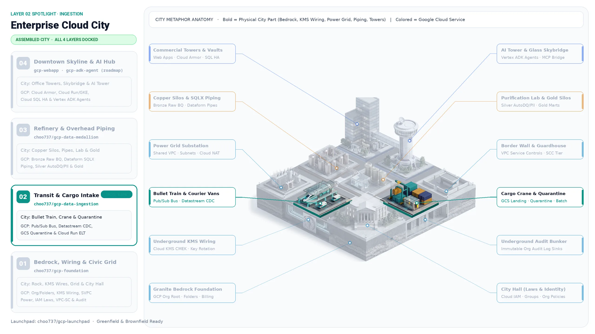
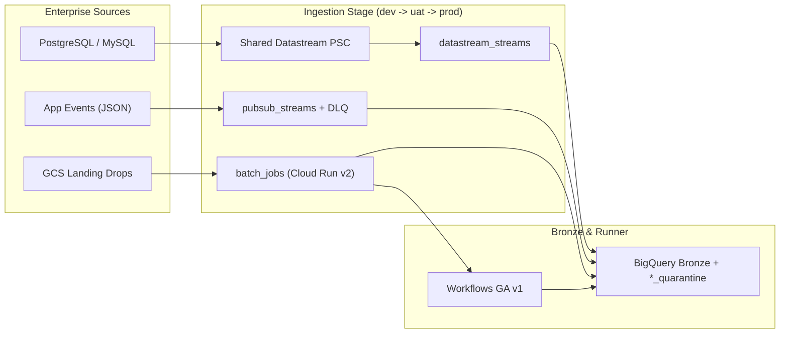

[00 Launchpad](https://github.com/choo737/gcp-launchpad) · [01 Foundation](https://github.com/choo737/gcp-foundation) · **02 Ingestion** · [03 Medallion](https://github.com/choo737/gcp-data-medallion) · [04 Data Science](https://github.com/choo737/gcp-data-science)

# GCP Data Ingestion

Manage enterprise Bronze ingestion pipelines across `dev`, `uat`, and `prod` in one private repository.
Supports Greenfield `gcp-foundation` links, Brownfield VPC and BigQuery inputs, and single-project sandboxes.



## Quick Orientation

Link outputs from [gcp-foundation](https://github.com/choo737/gcp-foundation) or generate `00_linked.auto.tfvars.json` via [gcp-launchpad](https://github.com/choo737/gcp-launchpad).

| Consumes From | Deploys | Hands Off To | Standalone Ready? |
| --- | --- | --- | --- |
| `00_linked.auto.tfvars.json` or [QUESTIONNAIRE.md](QUESTIONNAIRE.md) | Datastream CDC, Pub/Sub + DLQ, Cloud Run batch, Workflows | Bronze tables and `ops_telemetry.pipeline_runs` | Yes (`stages/sandbox` or Brownfield) |

## Start in 3 Steps

1. **Create your private repository** (GitHub forces standard forks of public repos to stay public):

```bash
gh repo create example-org/gcp-data-ingestion --private --template choo737/gcp-data-ingestion --clone
cd gcp-data-ingestion
gh repo view --json isPrivate --jq '.isPrivate'
```

Confirm `gh repo view` prints `true` before saving `00_linked.auto.tfvars.json` or `envs/<env>.tfvars`.

2. **Run with your AI coding agent** (`Claude Code`, `OpenAI Codex`, `Gemini CLI`, or `Antigravity`):

```text
Read AGENTS.md, QUESTIONNAIRE.md, and .agents/skills/setup-data-ingestion/SKILL.md.
Check platform-context.json, link stages/enterprise or stages/sandbox, and deploy active ingestion tracks.
```

3. **Verify locally**:

```bash
make fmt-check
make validate
make test
```

## Platform Districts

| Repository | District & Layer | Core Capabilities | Status |
| --- | --- | --- | --- |
| [gcp-launchpad](https://github.com/choo737/gcp-launchpad) | `00` City Planning Hub | Intake Q&A, preflight check, and Brownfield bridge | Active |
| [gcp-foundation](https://github.com/choo737/gcp-foundation) | `01` Governance & Utilities | Folders, 38 Org Policies, Shared VPC, VPC-SC, KMS, and SCC | Active |
| **gcp-data-ingestion** *(this repo)* | `02` Entry Ports & Bridges | Pub/Sub + DLQ, Datastream CDC, Cloud Run jobs, and Workflows | Active |
| [gcp-data-medallion](https://github.com/choo737/gcp-data-medallion) | `03` Warehouses & Quality | BigQuery Bronze/Silver/Gold, Dataform, and Knowledge Catalog | Active |
| [gcp-data-science](https://github.com/choo737/gcp-data-science) | `04` Offices, AI & Homes | Agent Platform, BigQuery ML, TreeSHAP XAI, and WORM ledger | Active |
| `gcp-webapp` *(Planned)* | Hosted App Template | HTTPS Load Balancer, Cloud Armor, Cloud Run, and Cloud SQL | Roadmap |
| `gcp-adk-agent` *(Planned)* | Hosted Agent Template | Google ADK on Agent Runtime or Cloud Run with eval gates | Roadmap |

## Technical Reference

<details open>
<summary><strong>1. Architecture, Mermaid Flow & 2026 Product Naming</strong></summary>

One enterprise stage hosts multiple CDC streams, Pub/Sub topics, and Cloud Run batch loaders.



1. **Datastream CDC (`datastream-cdc`)**: Streams PostgreSQL or MySQL changes using Secret Manager passwords and shared PSC connectivity.
2. **Pub/Sub to BigQuery (`pubsub-bigquery`)**: Validates JSON events, applies BigQuery Policy Tags (formerly Data Catalog), and quarantines errors.
3. **Batch ELT Job (`batch-elt-job` + `jobs/gcs_to_bronze/`)**: Runs atomic Cloud Run v2 loads with Direct VPC egress and policy tags.
4. **Pipeline Workflows (`pipeline-workflows` + `workflows/`)**: Runs batch loads, Dataform `v1`, Knowledge Catalog (formerly Dataplex) scans, and telemetry.

### Day-2 Multi-Pipeline Example

Add streams, batch feeds, and CDC databases directly in `stages/enterprise/envs/<env>.tfvars` and `schemas/`:

```hcl
enable_shared_datastream_private_connection = true

pubsub_streams = {
  crm-events = {
    target_table_id          = "crm_events_stream"
    schema_type              = "PROTOCOL_BUFFER"
    schema_file              = "schemas/pubsub/crm_events.proto"
    target_table_schema_file = "schemas/bigquery/crm_events_bronze.json"
    target_clustering        = ["segment", "event_type"]
  }
}

batch_jobs = {
  erp-invoices = {
    source_prefix            = "incoming/erp_invoices/"
    target_table             = "erp_invoices_bronze"
    source_format            = "NEWLINE_DELIMITED_JSON"
    partition_field          = "invoice_date"
    target_table_schema_file = "schemas/bigquery/erp_invoices_bronze.json"
  }
}

datastream_streams = {
  erp-db = {
    source_engine              = "POSTGRESQL"
    db_host                    = "10.20.2.15"
    db_username                = "datastream_rep"
    db_database                = "erp_prod"
    db_password_secret_version = "projects/example-etl-project/secrets/ent-erp-db-pwd/versions/1"
    included_objects           = { public = ["invoices", "vendors"] }
  }
}
```

- **2026 data names**: Uses Workflows (formerly Cloud Workflows) and Knowledge Catalog (formerly Dataplex).
- **2026 Airflow name**: Uses Managed Airflow Gen 3 (formerly Cloud Composer 3) for reference DAGs.
- **2026 AI name**: Uses Agent Runtime (formerly Vertex AI Agent Engine) for `gcp-adk-agent`.

</details>

<details open>
<summary><strong>2. Prerequisites, Keyless WIF CI/CD & Cost Guardrails</strong></summary>

Link upstream outputs first using `scripts/link-stages.sh` (Greenfield) or `generate-brownfield-link.py` (Brownfield).

| Tier | Profile | CI Identity Scope | GitHub Plan Gating |
| --- | --- | --- | --- |
| `S` | Small pilot (`1-5` engineers) | Single deployer WIF SA (`GCP_WIF_SERVICE_ACCOUNT`) | `github_free` branch rules |
| `M` | Growth (`5-20` engineers) | Scoped `tf_ingestion_ci` WIF SA | `github_team` `CODEOWNERS` reviews |
| `L` | Regulated SoD + Vendor Split | Per-environment WIF SAs (`dev`, `uat`, `prod`) | `github_enterprise` Environment Reviewers |

| GitHub Variable | Purpose | Source |
| --- | --- | --- |
| `GCP_WIF_PROVIDER` | Keyless GitHub OIDC provider resource name | `gcp-foundation` `00-bootstrap` |
| `GCP_WIF_SERVICE_ACCOUNT` | Scoped `tf_ingestion_ci` service account email | `gcp-foundation` `00-bootstrap` |
| `GCP_TFSTATE_BUCKET` | Hardened GCS state bucket (`ingestion/...`) | `gcp-foundation` `00-bootstrap` |

- **Zero-idle baseline**: Serverless Cloud Run jobs, Pub/Sub, and Workflows cost `$0/mo` when idle (`enable_schedule = false` in `dev`).
- **CI checks**: `.github/workflows/ci.yml` runs formatting, `terraform validate`, and Python unit tests offline.
- **Image build & deploy**: `build-batch-loader.yml` pushes `@sha256` digests; `terraform-deploy.yml` promotes `dev`, `uat`, and `prod`.

</details>

<details open>
<summary><strong>3. Repository Layout, Agent Skills & Day-0 to Day-2 Guides</strong></summary>

### Antigravity or OpenAI Codex

```text
Read AGENTS.md, QUESTIONNAIRE.md, and .agents/skills/setup-data-ingestion/SKILL.md.
Check platform-context.json or ask intake questions, create a private repo, link outputs, and deploy stages/enterprise.
```

### Claude Code

```text
Read CLAUDE.md, QUESTIONNAIRE.md, and .agents/skills/setup-data-ingestion/SKILL.md.
Verify gcloud auth, collect intake values, link stages/enterprise, and add pipelines via envs/<env>.tfvars.
```

| Skill | File | Purpose |
| --- | --- | --- |
| `setup-data-ingestion` | `.agents/skills/setup-data-ingestion/SKILL.md` | Private repo creation, stage linking, Terraform deploy, and canary checks |
| `add-streaming-topic` | `.agents/skills/add-streaming-topic/SKILL.md` | Add a schema-checked Pub/Sub BigQuery stream via `pubsub_streams` |
| `add-batch-feed` | `.agents/skills/add-batch-feed/SKILL.md` | Add a Cloud Run v2 GCS batch feed via `batch_jobs` |
| `add-cdc-source` | `.agents/skills/add-cdc-source/SKILL.md` | Add a PostgreSQL or MySQL CDC stream via `datastream_streams` |
| `split-domain-ingestion` | `.agents/skills/split-domain-ingestion/SKILL.md` | Split one ingestion repo into per-domain repos at scale |

### Repository Layout

- `README.md`, `QUESTIONNAIRE.md`, `AGENTS.md`, `CLAUDE.md`, `CODEOWNERS`, `Makefile`: Suite entry and review files.
- `modules/ingestion/`: Five-file Terraform modules (`datastream-cdc`, `pubsub-bigquery`, `batch-elt-job`, `pipeline-workflows`).
- `schemas/`: Proto3/Avro definitions (`schemas/pubsub/`) and BigQuery JSON schemas (`schemas/bigquery/`).
- `stages/`: `stages/sandbox/` and `stages/enterprise/` (`envs/{dev,uat,prod}.tfvars.example`).
- `jobs/gcs_to_bronze/`, `workflows/`, `composer_reference/`: Cloud Run loader, Workflows GA `v1`, and Airflow Gen 3 DAG.
- `scripts/`, `docs/`, `assets/`, `tests/`: Stage linker, adoption guides, diagrams, and unit tests.

### Day-0 to Day-2 Guides & Sibling Playbooks

- [Intake Questionnaire (Greenfield and Brownfield)](QUESTIONNAIRE.md)
- [Ingestion Decision Guide](docs/01-ingestion-decision-guide.md)
- [Repository Scaling and Managed Airflow Guide](docs/02-repo-scaling-and-composer.md)
- [Enterprise Adoption and Day-2 Guide](docs/03-enterprise-adoption-guide.md)
- [GCP Launchpad (Suite Router and Brownfield Bridge)](https://github.com/choo737/gcp-launchpad)
- [GCP Foundation (Upstream Platform and Governance)](https://github.com/choo737/gcp-foundation)
- [GCP Data Medallion (Downstream Dataform SQLX Models)](https://github.com/choo737/gcp-data-medallion)
- [GCP Data Science (Regulated ML and XAI)](https://github.com/choo737/gcp-data-science)

</details>

## License

Apache License 2.0. See [LICENSE](LICENSE).

**Disclaimer:** This is a personal project. The views, code, and opinions expressed are my own and do not represent my current or past employers.
