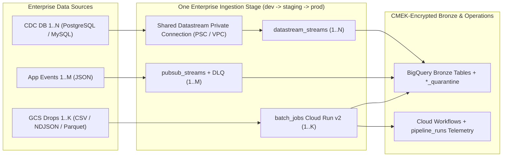

# Enterprise Adoption and Day-2 Guide

Keep every Bronze ingestion pipeline inside one private repository across `dev`, `staging`, and `prod`.

Teams add new feeds declaratively in `stages/enterprise/envs/<env>.tfvars` without editing `main.tf`.

For the end-to-end multi-repo playbook, start with [gcp-launchpad](https://github.com/choo737/gcp-launchpad), [gcp-foundation](https://github.com/choo737/gcp-foundation), and [gcp-data-medallion](https://github.com/choo737/gcp-data-medallion).

## Architecture and Multi-Pipeline Model

One enterprise stage hosts `1..N` CDC databases, `1..M` Pub/Sub streams, and `1..K` batch loaders.

All Datastream CDC streams can share one Private Service Connect (`PSC`) or VPC private connection.



- **Zero `main.tf` drift**: Declare new pipelines inside `pubsub_streams`, `batch_jobs`, and `datastream_streams` maps.
- **Collision-free batch identities**: Each `batch_jobs` entry derives a unique service account ID from `job_suffix`.
- **Shared Datastream networking**: One stage-level `google_datastream_private_connection.shared` serves all CDC databases.

---

## Step 1 — Day 0: Private Repo, Branch Protection, and Environments

Never store customer configuration or variable files inside a public GitHub fork.

Create a private repository from this template first:

```bash
gh repo create <org>/gcp-data-ingestion --private --template choo737/gcp-data-ingestion --clone
cd gcp-data-ingestion
gh repo view --json isPrivate --jq '.isPrivate'
```

Confirm the last command prints `true`.

Apply these repository controls before inviting pipeline contributors:

1. Update `CODEOWNERS` with your real GitHub platform and data engineering team slugs.
2. Protect `main` to require pull requests and passing `CI` workflow checks (`make fmt-check`, `make validate`, `make test`).
3. Create GitHub Environments named `dev`, `staging`, and `prod`.
4. Add required human reviewers on the `prod` environment before Terraform applies run.
5. Set repository or environment variables for Workload Identity Federation (`WIF`):

| Variable | Scope | Purpose |
| --- | --- | --- |
| `TF_STATE_BUCKET` | Per environment | GCS bucket holding Terraform state per environment |
| `GCP_WIF_PROVIDER` | Repo or env | Workload Identity Provider resource path |
| `GCP_SERVICE_ACCOUNT` | Repo or env | Deployer service account email |
| `ARTIFACT_REGISTRY_URI` | Repo or env | Regional Artifact Registry repository base URI |
| `ARTIFACT_REGISTRY_REPOSITORY` | Repo or env | Registry repository path read by `build-batch-loader.yml` |
| `IAC_OUTPUTS_BUCKET` | Optional | GCS bucket holding exported `gcp-foundation` JSON outputs |

---

## Step 2 — Day 1: Link Landing Zone (Greenfield or Brownfield)

Link upstream project IDs, KMS keys, networks, and policy tags into gitignored `stages/enterprise/00_linked.auto.tfvars.json`.

### Option A: Greenfield Enterprise (`gcp-foundation`)

Pull non-sensitive outputs exported by `gcp-foundation` per environment:

```bash
./scripts/link-stages.sh --env dev \
  --from-gcs gs://<state-bucket>/foundation-dev.json \
  stages/enterprise
```

You can also link local `gcp-foundation` stage directories directly:

```bash
./scripts/link-stages.sh --env dev \
  ../gcp-foundation/foundation/02-security-network \
  ../gcp-foundation/data/enterprise/01-platform \
  ../gcp-foundation/data/enterprise/02-governance-ops \
  stages/enterprise
```

### Option B: Brownfield Enterprise (Existing Projects)

Complete [QUESTIONNAIRE.md](../QUESTIONNAIRE.md) with your existing VPC, KMS, BigQuery, and Dataform identifiers.

If you exported `platform-context.json` from [gcp-launchpad](https://github.com/choo737/gcp-launchpad), run its generator script:

```bash
python3 ../gcp-launchpad/scripts/generate-brownfield-link.py \
  --context platform-context.json \
  --output stages/enterprise/00_linked.auto.tfvars.json
```

Verify `00_linked.auto.tfvars.json` permissions remain `0600` and never commit it to Git.

---

## Step 3 — Day 1: Build Immutable Loader Image and Store Secrets

Build the `jobs/gcs_to_bronze` container once and pin its immutable `@sha256` digest.

1. Run the GitHub Actions workflow `.github/workflows/build-batch-loader.yml` via `workflow_dispatch` or push to `main`.
2. Copy the output `gcs-to-bronze@sha256:...` URI from the workflow summary.
3. Paste that immutable digest into `batch_container_image` inside `stages/enterprise/envs/staging.tfvars` and `prod.tfvars`.

Store every source database replication password only in regional Secret Manager:

```bash
printf '%s' "${DB_PASSWORD}" | gcloud secrets create "${PREFIX}-erp-db-pwd" \
  --project="${ETL_PROJECT}" \
  --replication-policy="user-managed" \
  --locations="asia-southeast1" \
  --data-file=-
```

Record the version path `projects/${ETL_PROJECT}/secrets/${PREFIX}-erp-db-pwd/versions/1`.

Never place raw passwords inside `.tfvars`, JSON files, or Terraform variables.

---

## Step 4 — Day 1: Promote Baseline (`dev` to `staging` to `prod`)

Start with `dev` using safe defaults, then promote through `staging` and `prod`.

```bash
cp stages/enterprise/envs/dev.tfvars.example stages/enterprise/envs/dev.tfvars
make init STAGE=enterprise ENV=dev TF_STATE_BUCKET=<tf-state-bucket>
make plan STAGE=enterprise ENV=dev
make apply STAGE=enterprise ENV=dev
```

Follow these environment safety rules during promotion:

- Keep `enable_schedule = false` in `dev` so manual runs test pipelines first.
- Keep `batch_vpc_egress = "ALL_TRAFFIC"` in `prod` for strict egress firewall control.
- Keep `delete_contents_on_destroy = false` in `staging` and `prod` to protect Bronze tables.
- Promote via `.github/workflows/terraform-deploy.yml` after verifying `dev` and `staging` runs.

---

## Step 5 — Day 2: Adding Pipelines #2, #3, and Beyond (Zero `main.tf` Edits)

Teams add new ingestion feeds by editing `envs/<env>.tfvars` and placing schema files under `schemas/`.

Never duplicate `module` blocks inside `stages/enterprise/main.tf`.

### A. Add a New Pub/Sub Event Stream

1. Save the proto3 schema under `schemas/pubsub/crm_events.proto`.
2. Save the matching BigQuery schema under `schemas/bigquery/crm_events_bronze.json`.
3. Include `subscription_name`, `message_id`, `publish_time`, and `attributes` in that BigQuery JSON file.
4. Add an entry to `pubsub_streams` inside `stages/enterprise/envs/<env>.tfvars`:

```hcl
pubsub_streams = {
  crm-events = {
    target_table_id          = "crm_events_stream"
    schema_type              = "PROTOCOL_BUFFER"
    schema_file              = "schemas/pubsub/crm_events.proto"
    target_table_schema_file = "schemas/bigquery/crm_events_bronze.json"
    target_clustering        = ["segment", "event_type"]
  }
}
```

### B. Add a New GCS Batch Feed

Each entry in `batch_jobs` gets a distinct `source_prefix`, `partition_field`, and isolated service account.

Set `partition_field = ""` when the table has no `DATE` column and needs ingestion-time `DAY` partitioning.

```hcl
batch_jobs = {
  erp-invoices = {
    source_prefix            = "incoming/erp_invoices/"
    target_table             = "erp_invoices_bronze"
    source_format            = "NEWLINE_DELIMITED_JSON"
    partition_field          = "invoice_date"
    target_clustering        = ["entity_code", "invoice_status"]
    target_table_schema_file = "schemas/bigquery/erp_invoices_bronze.json"
  }
}
```

### C. Add a New PostgreSQL or MySQL CDC Database

Enable one shared private connection once so all CDC streams reuse it:

```hcl
enable_shared_datastream_private_connection = true

datastream_streams = {
  erp-db = {
    source_engine              = "POSTGRESQL"
    db_host                    = "10.20.2.15"
    db_username                = "datastream_rep"
    db_database                = "erp_prod"
    db_password_secret_version = "projects/<etl-project>/secrets/ent-erp-db-pwd/versions/1"
    included_objects           = { public = ["invoices", "vendors"] }
    cdc_mode                   = "APPEND_ONLY"
  }
}
```

### D. Day-2 Validation and Promotion Loop

1. Run `make fmt-check && make validate && make test` locally before opening your pull request.
2. Merge to `main` and deploy to `dev`.
3. Publish one valid event and one malformed event to test the live table and `*_quarantine` DLQ.
4. Register a `type: "declaration"` SQLX file for the new Bronze table in `gcp-data-medallion/definitions/01_bronze/`.
5. Promote the change through `staging` and `prod` via `.github/workflows/terraform-deploy.yml`.

---

## Step 6 — Day-2 Operations, Quarantine Replay, and When to Split

Operate live pipelines using telemetry tables, Cloud Monitoring alerts, and quarantine prefixes.

- **Workflow telemetry**: Query `ops_telemetry.pipeline_runs` to inspect `execution_id`, `status`, and `recorded_at`.
- **Alert routing**: Configure `alert_email_addresses` or `notification_channel_ids` to capture workflow failures in Cloud Monitoring.
- **Pub/Sub DLQ replay**: Inspect malformed payloads inside `<target_table_id>_quarantine`, fix upstream producers, and republish corrected JSON.
- **Batch quarantine replay**: Check `.error.json` sidecars under `quarantine/`, repair source files, and drop them back under `source_prefix`.
- **When to split repositories**: Keep one repository up to roughly `15` to `30` pipelines before splitting by business domain.

See [Repository Scaling and Cloud Composer Guide](02-repo-scaling-and-composer.md) for domain-split steps and Composer 3 cost triggers.

## Related Suite Guides

- [GCP Launchpad](https://github.com/choo737/gcp-launchpad): End-to-end multi-repo operational playbook and Brownfield bridge.
- [GCP Foundation](https://github.com/choo737/gcp-foundation): Upstream landing zone, IAM, KMS, VPC, and Dataform repository setup.
- [GCP Data Medallion](https://github.com/choo737/gcp-data-medallion): Downstream Bronze declarations, Silver SCD Type 2, and Gold marts.
